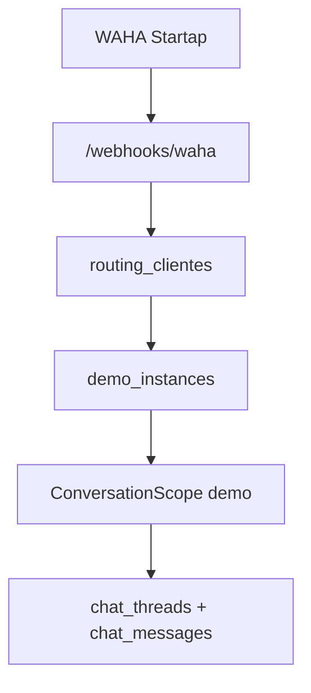
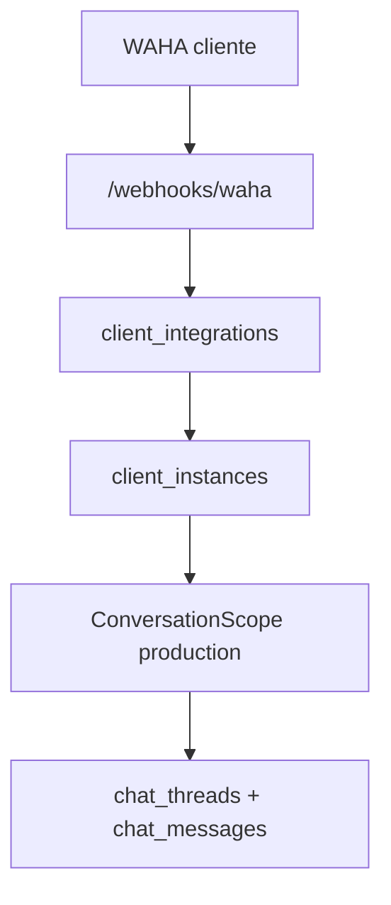

# Conversation Scope

## Motivo

O isolamento de historico e um requisito critico. O mesmo telefone pode conversar com produtos diferentes, testar uma demo e depois entrar em producao, ou participar de projetos diferentes do mesmo cliente. Cada uma dessas situacoes precisa de memoria separada.

## Tipo Base

```ts
export interface ConversationScope {
  environment: 'demo' | 'production';
  productId: string;
  instanceType: 'demo' | 'client';
  instanceId: string;
  clientId: string | null;
  projectId: string | null;
  userPhone: string;
  wahaSession: string;
}
```

## Regras

- `environment = demo` exige `instanceType = demo`.
- `environment = production` exige `instanceType = client`.
- `clientId` e `projectId` devem ser nulos em demo.
- `clientId` e `projectId` devem existir em producao.
- `userPhone` deve ser normalizado antes de criar ou buscar memoria.
- `wahaSession` deve entrar nos logs e metricas, mas nao substitui o escopo logico.

## Chave Unica Recomendada

```text
environment,
product_id,
instance_type,
instance_id,
client_id,
project_id,
user_phone
```

## Fluxo Demo



## Fluxo Producao



## Invariantes

- Demo nunca le memoria de producao.
- Producao nunca le memoria de demo.
- Produto A nunca le memoria de Produto B.
- Cliente A nunca le memoria de Cliente B.
- Projeto A nunca le memoria de Projeto B.
- Tabelas legadas devem continuar disponiveis ate migracao validada.

