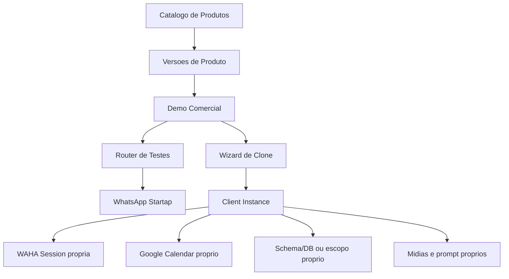

# Startap Platform Architecture

## Objetivo

A Startap Platform deve evoluir de bots migrados do automação visual antiga para uma plataforma multi-produto, multi-cliente e operacionalmente segura.

O fluxo alvo e:

```text
Produto homologado -> demo comercial -> teste via router -> cliente aprovado -> clone isolado em producao
```

## Principios

- `main` e a unica fonte de verdade para producao.
- Demos comerciais e clientes reais sao ambientes distintos.
- O router atende apenas testes comerciais.
- Cliente real e resolvido por instancia WAHA e integracoes proprias.
- Historico de conversa nunca pode misturar ambiente, produto, instancia, cliente, projeto ou telefone.
- Prompts, midias, precos, horarios e regras comerciais devem sair do codigo e ir para configuracao versionada.
- Segredos nao entram em Git, logs, painel ou documentacao operacional.

## Estado Atual

O sistema roda em TypeScript/Node com:

- `apps/api`: API Fastify que recebe webhooks WAHA.
- `apps/worker`: jobs recorrentes.
- `packages/core`: tipos, logger e utilitarios.
- `packages/db`: acesso Postgres.
- `packages/integrations`: WAHA, OpenAI, Whisper e Google Calendar.
- `painel-admin`: painel operacional atual.

Ainda existem hardcodes nos bots e tabelas legadas de memoria vindas da migracao do automação visual antiga.

## Arquitetura Alvo



## Ambientes

### Demo

Usado pelo comercial para validar produtos homologados com prospects.

- Usa WhatsApp/sessao de teste da Startap.
- Usa `routing_clientes`.
- Pode compartilhar agenda e midias demo.
- Pode ter overrides de prompt e dados comerciais.
- Nao pode ser usado como producao de cliente.

### Production

Usado por clientes reais apos aprovacao.

- Nao depende do router de teste.
- Resolve instancia pela sessao WAHA ou integracao cadastrada.
- Exige `client_id` e `project_id`.
- Usa credenciais, calendario, midias e configuracoes proprias.

## Conceitos

### Product

Modelo homologado reutilizavel, como `curso-barbeiro` ou `barbearia-agendamento`.

### Product Version

Snapshot versionado do comportamento do produto. Uma versao publicada nunca deve ser editada diretamente.

### Demo Instance

Instancia comercial baseada em um produto e uma versao especifica.

### Client

Empresa ou pessoa que contratou a solucao.

### Client Project

Projeto ou unidade operacional de um cliente. Em producao, o projeto e obrigatorio.

### Client Instance

Instancia real clonada de demo ou produto, com isolamento operacional.

## Ordem de Implementacao

1. Consolidar `feat/model-config-and-usage` em `main`.
2. Versionar esta documentacao no repo.
3. Introduzir `ConversationScope` e memoria isolada.
4. Criar catalogo de produtos e versoes.
5. Criar demos comerciais editaveis.
6. Adicionar midias editaveis.
7. Criar clone para cliente real isolado.
8. Endurecer seguranca, observabilidade e operacao.

## Contratos de Seguranca

- Nenhum segredo deve ser exposto pelo painel.
- Logs devem usar hash ou mascara para telefone quando o dado completo nao for necessario.
- Stack traces nao devem aparecer para usuarios finais.
- Qualquer segredo ja exposto deve ser considerado comprometido e rotacionado.

